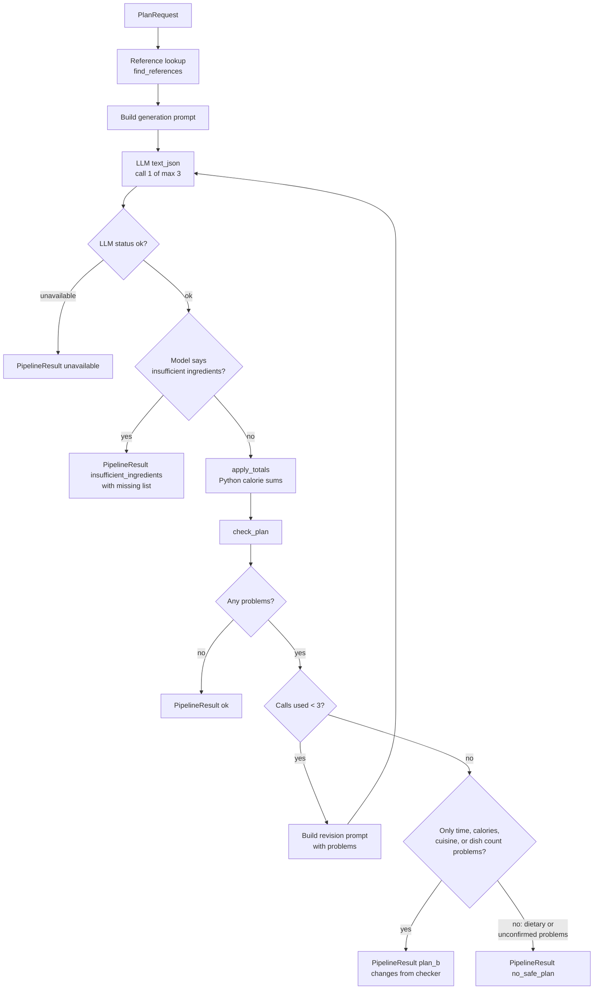
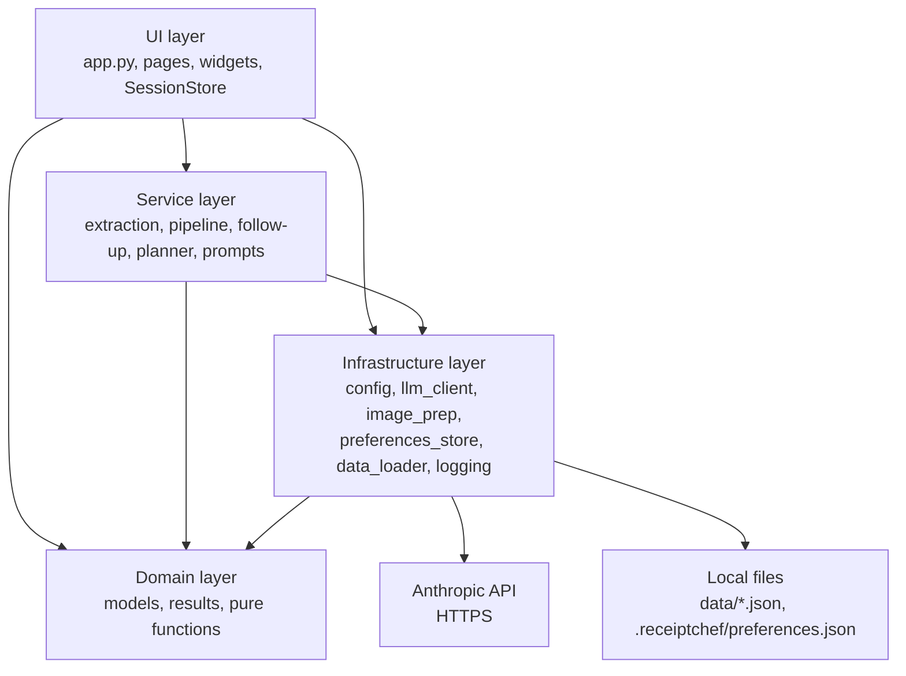
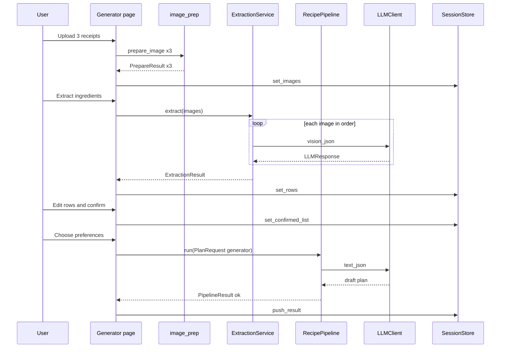
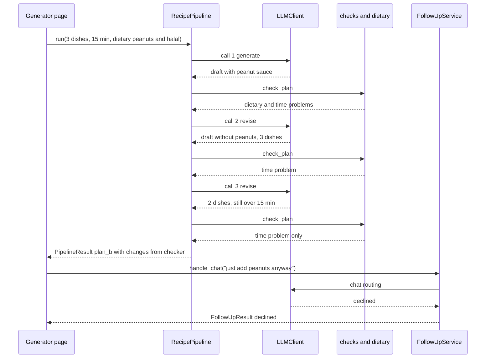

# ReceiptChef - Application Design (Consolidated)

**Stage**: INCEPTION - Application Design
**Date**: 2026-11-24
**Answers used**: Q1 B (layered packages), Q2 A (multipage UI), Q3 A (typed SessionStore), Q4 A (`prompts.py`), Q5 A (one shared RecipePipeline), Q6 A (one vision call per image, sequential), Q7 A (fixed button routing; chat returns answer or plan change), Q8 A (term list plus model tags), Q9 A (store units from the model during generation), Q10 B (`.receiptchef/preferences.json` in the project folder, git-ignored), Q11 B (result objects), Q12 A (`LLMClient` protocol with `FakeLLMClient`)

This document combines the four design artifacts in this folder. Detailed business rules are decided per unit in Functional Design (Construction).

## Summary

- **26 components** in four layers (UI, services, domain, infrastructure) plus 2 test-support components.
- **4 services**: ReceiptExtractionService, RecipePipeline (shared by Generator, Planner, Plan B, and follow-ups), FollowUpService, PlannerService.
- **Key design decision D-1**: Plan B uses the result of the last allowed generation call (no extra call). The "Changes from your request" list is computed by the Python checker, and dietary problems can never become a change; if they remain, no plan is shown.
- **Dependencies** flow one way: UI -> services -> domain, with infrastructure used by UI and services; the domain layer has no I/O.

## Extension Compliance

| Extension | Status |
|---|---|
| Security Baseline | Disabled - skipped |
| Resiliency Baseline | Disabled - skipped |
| Property-Based Testing (Partial) | No PBT rules apply at Application Design (N/A). The design supports later rules: pure domain functions for PBT-02 / PBT-03, and a shared `tests/strategies.py` for PBT-07. |

---

<!-- Source: components.md -->
# Part: Components

**Sources**: `application-design-plan.md` answers (Q1 B, Q2 A, Q3 A, Q4 A, Q5 A, Q6 A, Q7 A, Q8 A, Q9 A, Q10 B, Q11 B, Q12 A), `requirements.md`, `stories.md`

### 1. Package Layout (Q1: B - Layered)

```text
src/receiptchef/
+-- app.py                    # Entry point: uv run streamlit run src/receiptchef/app.py
+-- ui/                       # Layer 1: Streamlit only
|   +-- pages/
|   |   +-- onboarding.py
|   |   +-- generator.py
|   |   +-- planner.py
|   |   +-- settings.py
|   +-- widgets/
|   |   +-- ingredient_table.py
|   |   +-- preference_form.py
|   |   +-- plan_view.py
|   |   +-- followup_panel.py
|   |   +-- shopping_list_view.py
|   |   +-- notices.py
|   +-- session.py            # SessionStore (Q3: A)
+-- services/                 # Layer 2: orchestration, no Streamlit imports
|   +-- extraction_service.py
|   +-- recipe_pipeline.py
|   +-- followup_service.py
|   +-- planner_service.py
|   +-- prompts.py            # Q4: A
+-- domain/                   # Layer 3: models and pure functions, no I/O
|   +-- models.py
|   +-- results.py            # Result objects (Q11: B)
|   +-- ingredients.py        # merge, duplicate flags
|   +-- calories.py
|   +-- checks.py
|   +-- dietary.py
|   +-- reference_search.py
|   +-- shopping.py
+-- infra/                    # Layer 4: external I/O
    +-- config.py
    +-- llm_client.py         # LLMClient protocol + AnthropicLLMClient (Q12: A)
    +-- image_prep.py
    +-- preferences_store.py
    +-- data_loader.py
    +-- logging_setup.py

data/
+-- reference_recipes.json    # about 30 dishes per cuisine
+-- dietary_terms.json        # Q8: A term list per restriction

tests/
+-- fakes/fake_llm_client.py  # FakeLLMClient with recorded responses
+-- strategies.py             # Hypothesis domain generators (PBT-07)
+-- fixtures/receipts/ ...

.receiptchef/preferences.json # Q10: B, created at runtime, listed in .gitignore
```

**Layer rule**: each layer may only import from layers below it. `domain/` imports nothing from the project except itself. Only `infra/llm_client.py` imports `anthropic`. Only `ui/` and `app.py` import `streamlit`.

---

### 2. Component Catalog

#### Layer 1 - UI

| ID | Component | Purpose | Responsibilities | Interface | Stories |
|---|---|---|---|---|---|
| C-01 | App shell (`app.py`) | Entry point and navigation | Load settings; show setup message if API key missing; route to onboarding on first launch; register pages with `st.navigation` (Q2: A); build services once per session | Streamlit entry point | TRU-01, ONB-01 |
| C-02 | Onboarding page | First-launch explanation and dietary form | Show intro, checklist, free text (200 chars), "I have none", "Skip" | Page function | ONB-01 |
| C-03 | Generator page | Receipt-to-recipe flow | Upload, extract, review table, confirm, preferences, show plan / Plan B, follow-up panel, handoff to Planner | Page function | UPL, REV, GEN, RES, PLB, FUP |
| C-04 | Planner page | Description-to-shopping-list flow | Description (500 chars), preferences, plan, follow-up panel, shopping list with "already have" | Page function | PLN, FUP |
| C-05 | Settings page | Manage preferences | View, edit, clear; notice when current plan used old preferences | Page function | ONB-03 |
| C-06 | UI widgets | Reusable display and input pieces | Ingredient table (highlights, "On receipt" column, limits), preference form, plan view (cards, totals, labels), follow-up panel (buttons with structured inputs, chat), shopping list view, notices | Render functions taking domain objects | REV, GEN-01, RES, PLB, FUP, PLN, TRU-03 |
| C-07 | SessionStore | Typed access to session data (Q3: A) | Hold images (in memory), extraction results, confirmed list, recipe preferences, current plan and plan history, conversation, planner state; no raw `st.session_state` keys in pages | Class with typed getters / setters | UPL-03, FUP-06, FUP-08, ERR-01 |

#### Layer 2 - Services

| ID | Component | Purpose | Responsibilities | Interface | Stories |
|---|---|---|---|---|---|
| C-08 | ReceiptExtractionService | Turn images into one ingredient list | One vision call per image, sequentially (Q6: A); schema validation with one retry (FR-2.8); per-image status; merge and duplicate flags via domain | `extract(...) -> ExtractionResult` | UPL-02, UPL-03, REV-01, TRU-02 |
| C-09 | RecipePipeline | Shared generate-check-revise loop (Q5: A) | Reference lookup, prompt build, generate, calculate, check, revise (max 2), Plan B / no-safe-plan / insufficient outcomes | `run(PlanRequest) -> PipelineResult` | GEN-02, PLB-01 to 03, FUP-09, PLN-01 |
| C-10 | FollowUpService | Buttons and chat (Q7: A) | Route fixed buttons to explain-only or plan-change; chat call returns `answer` or `plan_change`; plan changes go through RecipePipeline; local computation for "what else to buy" | `handle_action(...)`, `handle_chat(...)` | FUP-01 to 09, PLB-03 |
| C-11 | PlannerService | Planner entry and handoff | Build Planner requests for RecipePipeline; build shopping list; Generator-to-Planner handoff without a new model call | `propose(...)`, `shopping_list(...)`, `from_generator(...)` | PLN-01 to 04 |
| C-12 | Prompts (`prompts.py`) | All prompt text in one place (Q4: A) | One function per prompt; user and receipt text placed in clearly delimited data sections (NFR-2.4) | Pure functions returning prompt parts | GEN-02, FUP-08, TRU-03 |

#### Layer 3 - Domain

| ID | Component | Purpose | Responsibilities | Interface | Stories |
|---|---|---|---|---|---|
| C-13 | Models (`models.py`) | All structured data (Pydantic v2) | Field limits (60 chars, 60 items, 200 / 500 chars) enforced by validators | Pydantic classes | All |
| C-14 | Results (`results.py`) | Outcome objects (Q11: B) | `ExtractionResult`, `PipelineResult`, `FollowUpResult`, `LLMResponse`, `PreferencesLoadResult`, `PrepareResult` with status enums | Pydantic classes | ERR-01, PLB |
| C-15 | Ingredient merge (`ingredients.py`) | Combine receipts | Merge per-image items, drop non_food, flag duplicates, apply user edits | Pure functions | UPL-02, REV-02, REV-03 |
| C-16 | Calorie calculator (`calories.py`) | Arithmetic in Python | Per-dish and plan totals from per-ingredient estimates; reject impossible values; whole-number display | Pure functions | GEN-02, RES-01, RES-02 |
| C-17 | Constraint checker (`checks.py`) | Plan checks | Time, per-dish calories, cuisine, dish count, dietary (via C-18), unconfirmed ingredients; produce `CheckProblem` list and the "changes from request" list for Plan B | Pure functions | GEN-02, PLB-01, PLB-03 |
| C-18 | Dietary rules (`dietary.py`) | Dietary conflict detection (Q8: A) | Match ingredient names against `dietary_terms.json`; combine with model allergen tags; conflict from either source fails | Pure functions | ONB-02, PLB-03, PLN-01 |
| C-19 | Reference search (`reference_search.py`) | Pick reference dishes | Rank reference dishes by cuisine and ingredient overlap | Pure function | GEN-02 |
| C-20 | Shopping list builder (`shopping.py`) | Combined list | Combine quantities across dishes, attach model store-unit hints (Q9: A), auto-mark "already have" from confirmed list, manual marks | Pure functions | PLN-02, PLN-03, PLN-04 |

#### Layer 4 - Infrastructure

| ID | Component | Purpose | Responsibilities | Interface | Stories |
|---|---|---|---|---|---|
| C-21 | Config (`config.py`) | Settings from environment | Load `.env`; `ANTHROPIC_API_KEY` (optional at load, reported missing), `RECEIPTCHEF_MODEL`, preferences path | `load_settings() -> Settings` | TRU-01 |
| C-22 | LLM client (`llm_client.py`) | Only place that calls Anthropic (NFR-1.4, Q12: A) | `LLMClient` protocol; `AnthropicLLMClient` with one automatic retry on API failure, 4,000 output-token cap, JSON parsing and Pydantic validation | Protocol + class | All model stories, ERR-01 |
| C-23 | Image preparation (`image_prep.py`) | Safe images | Validate type and size, resize to 1568 px, strip EXIF, keep in memory | `prepare_image(...) -> PrepareResult` | UPL-01, TRU-02 |
| C-24 | Preferences store (`preferences_store.py`) | Local JSON file (Q10: B) | Read / write / delete `.receiptchef/preferences.json` in the project folder; report missing or corrupt | Class | ONB-01 to 03 |
| C-25 | Data loader (`data_loader.py`) | Bundled data | Load and validate `reference_recipes.json` and `dietary_terms.json` once | Functions | GEN-02, PLB-03 |
| C-26 | Logging setup (`logging_setup.py`) | Safe logging | Structured log events with allowed fields only (NFR-2.6) | `log_event(...)` | TRU-02 |

#### Test Support (outside `src/`)

| ID | Component | Purpose |
|---|---|---|
| T-01 | `FakeLLMClient` | Implements `LLMClient` with recorded responses; counts calls for "at most 3 generation calls" tests |
| T-02 | Hypothesis strategies (`tests/strategies.py`) | Reusable domain generators (PBT-07) |

---

### 3. Design Decisions Made During This Stage

These follow from the answers but were not asked directly. Please review them.

| ID | Decision | Reason |
|---|---|---|
| D-1 | **Plan B stays within the 3-call cap.** The generation response schema lets the model return either a plan that meets the request or a best-effort plan with stated conflicts. If the plan still fails non-dietary checks after the last allowed call, the app shows that plan **as Plan B**, and the "Changes from your request" list comes from the checker's problem list, not from the model. If dietary or confirmed-ingredient checks still fail, no plan is shown (`no_safe_plan`). | Keeps FR-5.6 (max 3 calls) and FR-7.4 (never mislabeled): unmet conditions are computed by Python. Dietary problems can never become a "change" (US-PLB-03). |
| D-2 | Multipage navigation uses `st.navigation` with page files in `ui/pages/`, so the layered layout (Q1: B) works with Streamlit pages (Q2: A). | Streamlit's legacy `pages/` folder must sit next to the entry file; `st.navigation` removes that constraint. |
| D-3 | `prompts.py` sits in `services/`. | Prompts are part of orchestration, not pure domain logic. |
| D-4 | Free-text dietary restrictions ("Other restrictions") are checked by model tags only, because the term list covers checklist items only. The UI notes that free-text items are checked by AI. | Q8: A term list cannot cover arbitrary text. |
| D-5 | "What else do I need to buy?" (US-FUP-07) is computed from the current plan without a model call. | The plan already lists additional and pantry items; saves cost. |
| D-6 | The LLM client path changes from `src/receiptchef/llm_client.py` (NFR-1.4) to `src/receiptchef/infra/llm_client.py`. The single-client rule is unchanged. Added as C-13 in `technical-environment-proposed-changes.md`. | Follows Q1: B. |

---

<!-- Source: component-methods.md -->
# Part: Component Methods

Signatures are Python 3.12 with type hints. They define inputs, outputs, and purpose only. **Business rules (exact checks, thresholds, merge logic, prompt wording) are defined later in Functional Design.** Names may be refined in Functional Design if needed, as long as the layer rules in `component-dependency.md` hold.

---

### 1. Domain Models (`domain/models.py`, C-13)

Key models only; fields are indicative.

```python
class Cuisine(StrEnum): CHINESE, ITALIAN, MEXICAN, NO_PREFERENCE
class CalorieRange(StrEnum): BELOW_400, FROM_400_TO_600, FROM_600_TO_800, NO_PREFERENCE
class ItemStatus(StrEnum): FOOD, UNCLEAR, NON_FOOD
class DietaryOption(StrEnum): PEANUTS, TREE_NUTS, DAIRY, EGGS, GLUTEN, SHELLFISH, VEGETARIAN, VEGAN, HALAL, NO_PORK, NO_BEEF

class DietaryPreferences(BaseModel):
    options: set[DietaryOption]
    other_text: str | None          # max 200 chars
    onboarding_state: Literal["saved", "none", "skipped"]

class ReceiptItem(BaseModel):
    image_index: int                # 0-2
    raw_text: str
    ingredient_name: str            # max 60 chars
    quantity: float | None
    unit: str | None
    status: ItemStatus
    explanation: str | None

class IngredientRow(BaseModel):     # one row of the review table
    row_id: str
    name: str                       # max 60 chars
    on_receipt: str | None          # read-only display, e.g. "2 lb"
    raw_text: str | None
    explanation: str | None
    needs_review: bool              # unclear or duplicate, unresolved
    duplicate_group: str | None
    source: Literal["receipt", "user"]

class ConfirmedIngredientList(BaseModel):
    items: list[str]                # max 60 items

class RecipePreferences(BaseModel):
    dish_count: Literal[1, 2, 3]
    max_total_minutes: Literal[15, 30, 45, 60]
    calorie_range: CalorieRange
    cuisine: Cuisine

class RecipeIngredient(BaseModel):
    name: str
    quantity: str                   # e.g. "300 g"
    estimated_kcal: int
    source: Literal["confirmed", "assumed_pantry", "additional"]
    allergen_tags: list[DietaryOption]   # model-declared (Q8: A)
    store_unit_hint: str | None          # model-suggested (Q9: A)

class Dish(BaseModel):
    name: str
    cuisine: Cuisine
    ingredients: list[RecipeIngredient]
    steps: list[str]
    kcal: int | None                # filled by calories.py, never by the model

class MealPlan(BaseModel):
    dishes: list[Dish]              # 1-3
    total_minutes: int
    time_assumptions: list[str]
    total_kcal: int | None          # filled by calories.py
    is_plan_b: bool
    changes_from_request: list[str] # filled by checks.py for Plan B
    purchase_label: Literal["confirmed_only", "requires_purchases"]

class CheckProblem(BaseModel):
    kind: Literal["time", "calories", "cuisine", "dish_count", "dietary", "unconfirmed_ingredient", "invalid_estimate"]
    dish_index: int | None
    detail: str

class ShoppingListItem(BaseModel):
    name: str
    combined_quantity: str          # e.g. "5 cloves"
    store_unit_hint: str | None     # labeled approximate
    already_have: bool
    auto_marked: bool               # came from Generator confirmed list

class ShoppingList(BaseModel):
    to_buy: list[ShoppingListItem]
    already_have: list[ShoppingListItem]

class FollowUpAction(BaseModel):
    kind: Literal["replace_ingredient", "different_dish", "change_dish_count", "adjust_preferences",
                  "explain_step", "other_meals", "identify_additional"]
    dish_index: int | None
    ingredient_name: str | None
    step_index: int | None
    replacement: str | None         # max 60 chars
    new_dish_count: int | None
    drop_dish_index: int | None
    new_preferences: RecipePreferences | None

class ChatTurn(BaseModel):
    role: Literal["user", "assistant"]
    text: str                       # user text max 500 chars
```

### 2. Result Objects (`domain/results.py`, C-14, Q11: B)

```python
class LLMResponse(BaseModel, Generic[M]):
    status: Literal["ok", "unavailable", "invalid_output"]
    value: M | None
    error_kind: str | None          # e.g. "timeout", "rate_limit"; never contains prompt text

class PrepareResult(BaseModel):
    status: Literal["ok", "rejected"]
    image: PreparedImage | None     # in-memory bytes + media type
    reason: str | None              # "too_large", "unsupported_type", "unreadable"

class ImageExtraction(BaseModel):
    image_index: int
    status: Literal["ok", "unreadable", "not_a_receipt", "invalid_output", "unavailable"]
    items: list[ReceiptItem]

class ExtractionResult(BaseModel):
    per_image: list[ImageExtraction]
    rows: list[IngredientRow]       # merged, non_food removed, duplicates flagged

class PipelineResult(BaseModel):
    status: Literal["ok", "plan_b", "insufficient_ingredients", "no_safe_plan", "unavailable"]
    plan: MealPlan | None
    conflict_explanation: str | None
    missing_ingredients: list[str]
    generation_calls: int           # 1-3
    problems_last_attempt: list[CheckProblem]

class FollowUpResult(BaseModel):
    kind: Literal["explanation", "plan_updated", "additional_list", "declined", "unavailable"]
    text: str | None
    pipeline: PipelineResult | None

class PreferencesLoadResult(BaseModel):
    status: Literal["missing", "ok", "corrupt"]
    preferences: DietaryPreferences | None
```

---

### 3. UI Layer

#### C-01 App shell (`app.py`)
| Method | Purpose |
|---|---|
| `main() -> None` | Load settings; if API key missing, render setup message and stop; load preferences; route to onboarding if missing / corrupt; register pages with `st.navigation`; run selected page |
| `build_services(settings: Settings) -> Services` | Create `AnthropicLLMClient`, data, and services once per session (cached) |

#### C-02 to C-05 Pages
| Method | Purpose |
|---|---|
| `onboarding.render(store: SessionStore, prefs_store: PreferencesStore) -> None` | Intro and dietary form |
| `generator.render(store: SessionStore, services: Services) -> None` | Generator flow |
| `planner.render(store: SessionStore, services: Services) -> None` | Planner flow |
| `settings.render(store: SessionStore, prefs_store: PreferencesStore) -> None` | Edit / clear preferences |

#### C-06 Widgets
| Method | Purpose |
|---|---|
| `ingredient_table.render(rows: list[IngredientRow]) -> list[IngredientRow]` | Editable table; returns edited rows |
| `preference_form.render(current: RecipePreferences \| None) -> RecipePreferences \| None` | Returns choices when submitted |
| `plan_view.render(result: PipelineResult) -> None` | Dish cards, totals, Plan B explanation and labels, notices |
| `followup_panel.render(plan: MealPlan, conversation: list[ChatTurn]) -> FollowUpAction \| str \| None` | Returns a button action or chat text |
| `shopping_list_view.render(sl: ShoppingList) -> set[str]` | Returns names the user marked as "already have" |
| `notices.allergen_notice() -> None`, `notices.calorie_notice() -> None` | Standard safety text |

#### C-07 SessionStore (`ui/session.py`)
| Method | Purpose |
|---|---|
| `images() -> list[PreparedImage]` / `set_images(images)` / `replace_image(index, image)` | In-memory receipt images |
| `extraction() -> ExtractionResult \| None` / `set_extraction(result)` | Latest extraction |
| `rows() -> list[IngredientRow]` / `set_rows(rows)` | Review table state |
| `confirmed_list() -> ConfirmedIngredientList \| None` / `set_confirmed_list(lst)` | Confirmed list |
| `recipe_preferences() -> RecipePreferences \| None` / `set_recipe_preferences(p)` | Last chosen preferences |
| `current_result() -> PipelineResult \| None` / `push_result(r)` / `previous_result() -> PipelineResult \| None` | Current plan and history (US-FUP-06) |
| `conversation() -> list[ChatTurn]` / `append_turn(turn)` | Chat history (session only) |
| `planner_state() -> PlannerState` / `set_planner_state(s)` | Planner description, plan, marks |
| `dietary() -> DietaryPreferences \| None` / `set_dietary(p)` | Cached copy of saved preferences |

---

### 4. Service Layer

#### C-08 ReceiptExtractionService
| Method | Purpose |
|---|---|
| `__init__(llm: LLMClient)` | Inject client |
| `extract(images: list[PreparedImage]) -> ExtractionResult` | One call per image in order; validation retry once per image; merge |
| `extract_one(image: PreparedImage, image_index: int) -> ImageExtraction` | Used for re-uploading one image (US-UPL-03) |
| `merge_into(existing: list[IngredientRow], new: ImageExtraction) -> list[IngredientRow]` | Add replacement-image items without losing edits |

#### C-09 RecipePipeline
| Method | Purpose |
|---|---|
| `__init__(llm: LLMClient, reference: ReferenceData, dietary_terms: DietaryTerms)` | Inject dependencies |
| `run(request: PlanRequest) -> PipelineResult` | Full loop: lookup, generate, calculate, check, revise (max 2), outcome |

```python
class PlanRequest(BaseModel):
    source: Literal["generator", "planner", "followup"]
    confirmed: ConfirmedIngredientList | None   # None for Planner from scratch
    description: str | None                     # Planner text, max 500 chars
    preferences: RecipePreferences
    dietary: DietaryPreferences
    current_plan: MealPlan | None               # for follow-up changes
    change: str | FollowUpAction | None         # chat change text or button action
```

#### C-10 FollowUpService
| Method | Purpose |
|---|---|
| `__init__(llm: LLMClient, pipeline: RecipePipeline)` | Inject dependencies |
| `handle_action(action: FollowUpAction, context: FollowUpContext) -> FollowUpResult` | Explain-only actions call the model for text; plan-changing actions call `pipeline.run`; `identify_additional` computed locally |
| `handle_chat(text: str, context: FollowUpContext) -> FollowUpResult` | Chat call returns `answer` or `plan_change`; plan change goes to `pipeline.run` |

`FollowUpContext` holds the current plan, confirmed list or Planner "already have" list, recipe preferences, dietary preferences, and the conversation.

#### C-11 PlannerService
| Method | Purpose |
|---|---|
| `__init__(pipeline: RecipePipeline)` | Inject pipeline |
| `propose(description: str, preferences: RecipePreferences, dietary: DietaryPreferences) -> PipelineResult` | Planner from scratch |
| `from_generator(result: PipelineResult, confirmed: ConfirmedIngredientList) -> PlannerState` | Handoff without a model call |
| `shopping_list(plan: MealPlan, confirmed: ConfirmedIngredientList \| None, manual_marks: set[str], unmarked: set[str]) -> ShoppingList` | Delegates to `domain.shopping` |

#### C-12 Prompts (`services/prompts.py`)
| Function | Purpose |
|---|---|
| `extraction_prompt() -> PromptParts` | System and instruction text for one receipt image |
| `generation_prompt(request: PlanRequest, references: list[ReferenceDish]) -> PromptParts` | First generation call |
| `revision_prompt(request: PlanRequest, previous: MealPlan, problems: list[CheckProblem]) -> PromptParts` | Revision call |
| `explain_prompt(plan: MealPlan, action: FollowUpAction, dietary: DietaryPreferences) -> PromptParts` | Explain a step |
| `chat_prompt(context: FollowUpContext, text: str) -> PromptParts` | Chat routing call |

`PromptParts` = system text + list of messages, with user and receipt text inside delimited data blocks.

---

### 5. Domain Functions

| Module | Function | Purpose |
|---|---|---|
| `ingredients.py` | `merge_extractions(per_image: list[ImageExtraction]) -> list[IngredientRow]` | Drop non_food, combine, flag duplicates |
| | `resolve_duplicate(rows, group_id: str, action: Literal["merge", "keep_both"]) -> list[IngredientRow]` | Apply user choice |
| | `pending_review_count(rows: list[IngredientRow]) -> int` | Items blocking confirmation |
| | `to_confirmed(rows: list[IngredientRow]) -> ConfirmedIngredientList` | Build confirmed list (fails if review pending or empty) |
| `calories.py` | `apply_totals(plan: MealPlan) -> tuple[MealPlan, list[CheckProblem]]` | Fill dish `kcal` and plan `total_kcal`; flag impossible estimates |
| | `display_kcal(value: int) -> str` | "about 513 kcal (approximate)" |
| `checks.py` | `check_plan(plan, preferences, dietary, confirmed, terms) -> list[CheckProblem]` | All checks |
| | `changes_from_request(problems: list[CheckProblem]) -> list[str]` | Plan B change list (never includes dietary) |
| | `purchase_label(plan: MealPlan) -> Literal["confirmed_only", "requires_purchases"]` | Plan B label |
| `dietary.py` | `find_conflicts(ingredients: list[RecipeIngredient], dietary: DietaryPreferences, terms: DietaryTerms) -> list[CheckProblem]` | Term list + model tags |
| `reference_search.py` | `find_references(cuisine: Cuisine, ingredients: list[str], data: ReferenceData, limit: int) -> list[ReferenceDish]` | Ranked matches |
| `shopping.py` | `build_shopping_list(plan, confirmed, manual_marks, unmarked) -> ShoppingList` | Combine quantities, attach hints, marks |
| | `combine_quantities(quantities: list[str]) -> str` | Combine like units |
| | `additional_items(plan: MealPlan) -> dict[int, list[RecipeIngredient]]` | For US-FUP-07 |

---

### 6. Infrastructure

#### C-21 Config
| Method | Purpose |
|---|---|
| `load_settings() -> Settings` | `api_key: str \| None`, `model: str` (default `claude-sonnet-5-5`), `preferences_path: Path` (`.receiptchef/preferences.json`) |

#### C-22 LLM client (`infra/llm_client.py`)
```python
class LLMClient(Protocol):
    def vision_json(self, prompt: PromptParts, image: PreparedImage, schema: type[M]) -> LLMResponse[M]: ...
    def text_json(self, prompt: PromptParts, schema: type[M]) -> LLMResponse[M]: ...

class AnthropicLLMClient:          # implements LLMClient
    def __init__(self, api_key: str, model: str, max_output_tokens: int = 4000) -> None: ...
```
One automatic retry on network error, rate limit, or timeout (FR-10.1). JSON parsing and Pydantic validation happen here; an invalid response returns `status="invalid_output"` (services decide whether to retry).

#### C-23 Image preparation
| Method | Purpose |
|---|---|
| `prepare_image(data: bytes, filename: str) -> PrepareResult` | Check type (JPEG / PNG / WebP) and size (10 MB), resize to 1568 px, strip EXIF |

#### C-24 Preferences store
| Method | Purpose |
|---|---|
| `__init__(path: Path)` | File location |
| `load() -> PreferencesLoadResult` | missing / ok / corrupt |
| `save(prefs: DietaryPreferences) -> None` | Create folder if needed; write JSON |
| `clear() -> None` | Delete file |

#### C-25 Data loader
| Method | Purpose |
|---|---|
| `load_reference_recipes(path: Path) -> ReferenceData` | Validated reference dishes |
| `load_dietary_terms(path: Path) -> DietaryTerms` | Validated term list |

#### C-26 Logging
| Method | Purpose |
|---|---|
| `configure_logging() -> None` | Set format and level |
| `log_event(stage: str, step: str, duration_ms: int, revisions: int \| None = None, error_kind: str \| None = None) -> None` | Only allowed fields can be logged |

---

### 7. Test Support

| Component | Methods |
|---|---|
| `FakeLLMClient` | `__init__(responses: list[object])`; implements `vision_json` and `text_json`; `calls: list[str]` for assertions such as "at most 3 generation calls" |
| `tests/strategies.py` | Hypothesis strategies: `dietary_preferences()`, `recipe_ingredients()`, `dishes()`, `meal_plans()`, `ingredient_rows()`, `quantities()` (PBT-07) |

---

<!-- Source: services.md -->
# Part: Services and Orchestration

Services live in `src/receiptchef/services/`. They contain no Streamlit code, receive their dependencies through the constructor (Q12: A), and return result objects (Q11: B). The UI decides how to display each result status.

---

### S-1 ReceiptExtractionService

**Responsibility**: Turn 1-3 prepared images into one reviewable ingredient list.

**Orchestration** (Q6: A, sequential):
1. For each image, in order:
   1. Build `extraction_prompt()`.
   2. Call `llm.vision_json(prompt, image, ReceiptExtractionSchema)`.
   3. If `status="invalid_output"`, retry once (FR-2.8). If still invalid, mark that image `invalid_output`.
   4. If `status="unavailable"` (after the client's own retry), mark the image `unavailable` and stop processing remaining images; the UI shows the "Try again" error (US-ERR-01).
   5. If the model reports unreadable or not a receipt, mark that image accordingly with no items.
2. `domain.ingredients.merge_extractions(per_image)` drops non_food items, combines items, and flags duplicates.
3. Return `ExtractionResult` with per-image status and merged rows.

**Re-upload one image** (US-UPL-03): `extract_one(...)` then `merge_into(existing_rows, new)` keeps the user's edits.

**Never**: writes images to disk, logs image content, returns payment or loyalty data (instructed in prompt; also not part of the schema).

---

### S-2 RecipePipeline (shared, Q5: A)

**Responsibility**: The only path that creates or changes a meal plan. Used by Generator, Planner, and plan-changing follow-ups.

**Orchestration**:



**Text alternative**: lookup references -> generate (call 1) -> if the API is unavailable, return `unavailable`; if the model says ingredients are insufficient, return `insufficient_ingredients` with the missing list -> compute calories in Python -> check -> if no problems, return `ok` -> otherwise revise with the problem list (up to 2 revisions, 3 calls total) -> after the last call, if only time / calories / cuisine / dish-count problems remain, return the plan as `plan_b` with the change list computed by the checker; if dietary or unconfirmed-ingredient problems remain, return `no_safe_plan`.

**Key rules** (detailed in Functional Design):
- Plan B never costs an extra call (design decision D-1 in `components.md`).
- Dietary problems are never converted into "changes from your request" (US-PLB-03).
- `invalid_output` from a generation call counts as a used call and is treated like a failed check with a "fix the format" problem.
- The model never supplies totals; `apply_totals` overwrites them.
- `generation_calls` is recorded in the result and logged.

**Request sources**:

| Source | `confirmed` | `description` | `current_plan` / `change` |
|---|---|---|---|
| Generator | Confirmed list | None | None |
| Planner | Generator list if present (for context only) or None | Planner text | None |
| Follow-up | Current list | Planner text if in Planner | Current plan + button action or chat change text |

---

### S-3 FollowUpService (Q7: A)

**Responsibility**: Handle follow-up buttons and chat for both Generator and Planner.

**Button routing (fixed)**:

| Button | Type | Handling |
|---|---|---|
| Replace an ingredient | Plan change | `pipeline.run(change=action)` |
| Suggest a different dish | Plan change | `pipeline.run(change=action)` |
| Change the number of dishes | Plan change | Dropping a dish: local removal then `apply_totals` + `check_plan` (no model call); adding: `pipeline.run` |
| Adjust time or calorie preference | Plan change | `pipeline.run(preferences=new)` |
| Suggest other meals | Plan change | `pipeline.run` with no current plan; UI keeps the previous result (US-FUP-06) |
| Explain a cooking step | Explain only | `llm.text_json(explain_prompt)` -> `FollowUpResult(kind="explanation")` |
| What else do I need to buy? | Explain only | `domain.shopping.additional_items(plan)`; no model call (D-5) |

**Chat routing**:
1. `llm.text_json(chat_prompt(context, text), ChatReplySchema)`; the reply type is `answer`, `plan_change`, or `declined`.
2. `answer` -> show text. `declined` (off topic, attempt to override rules or drop an allergy) -> show the short explanation (US-FUP-08, US-PLB-03).
3. `plan_change` -> `pipeline.run(change=<model's restated change>)`; the result goes through the same checks, so a chat request like "add peanuts anyway" cannot produce a peanut plan even if the model misroutes it.

**Every follow-up** receives the current plan, ingredient list (or Planner "already have" list), recipe preferences, and saved dietary preferences (FR-8.4).

---

### S-4 PlannerService

**Responsibility**: Planner entry, Generator-to-Planner handoff, and shopping list.

| Operation | Orchestration |
|---|---|
| `propose` | Build `PlanRequest(source="planner")` -> `pipeline.run` |
| `from_generator` | Copy current plan, preferences, and confirmed list into `PlannerState`; no model call (US-PLN-04) |
| `shopping_list` | `domain.shopping.build_shopping_list(plan, confirmed, manual_marks, unmarked)`; recalculated every time the plan changes (FR-9.9) |

Store-unit hints come from each `RecipeIngredient.store_unit_hint` produced during generation (Q9: A). When the same ingredient has different hints across dishes, the builder chooses one by a rule set in Functional Design.

---

### S-5 Cross-Cutting Patterns

| Concern | Pattern | Where |
|---|---|---|
| API failure | One automatic retry inside `AnthropicLLMClient`; then `status="unavailable"` result; UI shows "Try again"; SessionStore keeps all data | C-22, C-07, US-ERR-01 |
| Invalid model output | `status="invalid_output"`; extraction retries once; pipeline counts it as a used call | C-08, C-09 |
| Prompt injection | Prompts put receipt text, ingredient names, descriptions, and chat inside delimited data blocks; all outputs validated; all plans checked in Python | C-12, C-17, C-18 |
| Input limits | Pydantic validators on models; UI widgets enforce the same limits | C-13, C-06 |
| Cost limits | Max 3 generation calls per pipeline run; 4,000 output tokens per call | C-09, C-22 |
| Logging | `log_event` with allowed fields only; never prompts, images, keys, or dietary data | C-26 |
| Privacy | EXIF stripped before any call; images held only in SessionStore; only the preferences file is written | C-23, C-07, C-24 |
| Testability | Services receive `LLMClient`; tests inject `FakeLLMClient`; domain functions are pure for PBT | T-01, T-02 |

---

<!-- Source: component-dependency.md -->
# Part: Component Dependencies

### 1. Layer Dependencies



**Text alternative**: UI depends on services, domain, and infrastructure (for config, image preparation, and the preferences store). Services depend on domain and infrastructure (LLM client, data). Infrastructure depends on domain models only and talks to the Anthropic API and local files. Domain depends on nothing. There are no cycles.

**Rules**:
- `domain/` has no I/O and no imports from other project layers.
- Only `infra/llm_client.py` imports `anthropic`; only UI files import `streamlit`.
- Services depend on the `LLMClient` protocol, never on `AnthropicLLMClient` directly; `app.py` wires the real client.

---

### 2. Dependency Matrix

Rows depend on columns ("X" = direct dependency).

| Component | SessionStore | Extraction | Pipeline | FollowUp | Planner | Prompts | Domain | Config | LLM client | Image prep | Prefs store | Data loader | Logging |
|---|---|---|---|---|---|---|---|---|---|---|---|---|---|
| App shell | X | X | X | X | X | | X | X | X | | X | X | X |
| Onboarding / Settings pages | X | | | | | | X | | | | X | | |
| Generator page | X | X | | X | X | | X | | | X | | | |
| Planner page | X | | | X | X | | X | | | | | | |
| Widgets | | | | | | | X | | | | | | |
| SessionStore | | | | | | | X | | | | | | |
| ReceiptExtractionService | | | | | | X | X | | X | | | | X |
| RecipePipeline | | | | | | X | X | | X | | | | X |
| FollowUpService | | | X | | | X | X | | X | | | | X |
| PlannerService | | | X | | | | X | | | | | | |
| Prompts | | | | | | | X | | | | | | |
| LLM client | | | | | | | X | X | | | | | X |
| Image prep | | | | | | | X | | | | | | |
| Prefs store | | | | | | | X | | | | | | |
| Data loader | | | | | | | X | | | | | | |

---

### 3. Communication Patterns

| Pattern | Used for |
|---|---|
| Direct synchronous calls | All component interaction (single-process Streamlit app) |
| Constructor injection | `LLMClient`, reference data, and dietary terms passed into services |
| Result objects with status enums | Service -> UI outcomes (Q11: B) |
| Session-scoped state | SessionStore wraps `st.session_state`; services are stateless |
| File I/O | Preferences store (read / write / delete); data loader (read only, once) |
| Outbound HTTPS | LLM client -> Anthropic API only |

---

### 4. Data Flows for the Journeys

#### Journey A - Generator happy path



**Text alternative**: the page prepares each image, stores them, and calls the extraction service, which makes one vision call per image in order. The user edits and confirms the list; the page calls the pipeline, which generates, calculates, checks, and returns an `ok` result that is stored in the session.

#### Journey B - Plan B with a peanut allergy



**Text alternative**: the first draft has peanuts and is too slow; the revision removes peanuts; the final call still exceeds the time limit, so the pipeline returns the plan as Plan B with the time change listed by the checker. The chat request to add peanuts is declined. If the model had instead returned a plan change, the pipeline's dietary check would still block it.

#### Journey C - Generator to Planner

1. Generator page -> `RecipePipeline.run` -> `insufficient_ingredients` with missing list.
2. User clicks "What else do I need to buy?" -> `FollowUpService.handle_action(identify_additional)` -> `domain.shopping.additional_items` (no model call).
3. User clicks "Make a shopping list" -> `PlannerService.from_generator(result, confirmed)` -> SessionStore planner state (no model call).
4. Planner page -> `PlannerService.shopping_list(...)` -> `domain.shopping.build_shopping_list` auto-marks confirmed items.

#### Journey D - Planner from scratch

1. Planner page -> `PlannerService.propose(description, preferences, dietary)` -> `RecipePipeline.run(source="planner")` -> `ok`.
2. User changes to 2 dishes -> `FollowUpService.handle_action(change_dish_count, drop_dish_index)` -> local removal, `apply_totals`, `check_plan` -> `plan_updated`.
3. Planner page -> `PlannerService.shopping_list(...)` recalculated from the updated plan.
4. User marks rice and onions -> `shopping_list(..., manual_marks={"rice", "onion"})`.

---

### 5. Story-to-Component Coverage

| Epic | Main components |
|---|---|
| ONB | C-01, C-02, C-05, C-07, C-24, C-18 |
| UPL | C-03, C-07, C-08, C-15, C-23 |
| REV | C-03, C-06, C-07, C-15 |
| GEN | C-06, C-09, C-12, C-16, C-17, C-18, C-19, C-25 |
| RES | C-06, C-16 |
| PLB | C-06, C-09, C-17, C-18 |
| FUP | C-06, C-07, C-10, C-09, C-20 |
| PLN | C-04, C-11, C-20, C-09 |
| ERR | C-22, C-07, C-06 |
| TRU | C-01, C-21, C-23, C-26, C-06, C-12 |

All 33 stories map to at least one component.

---
