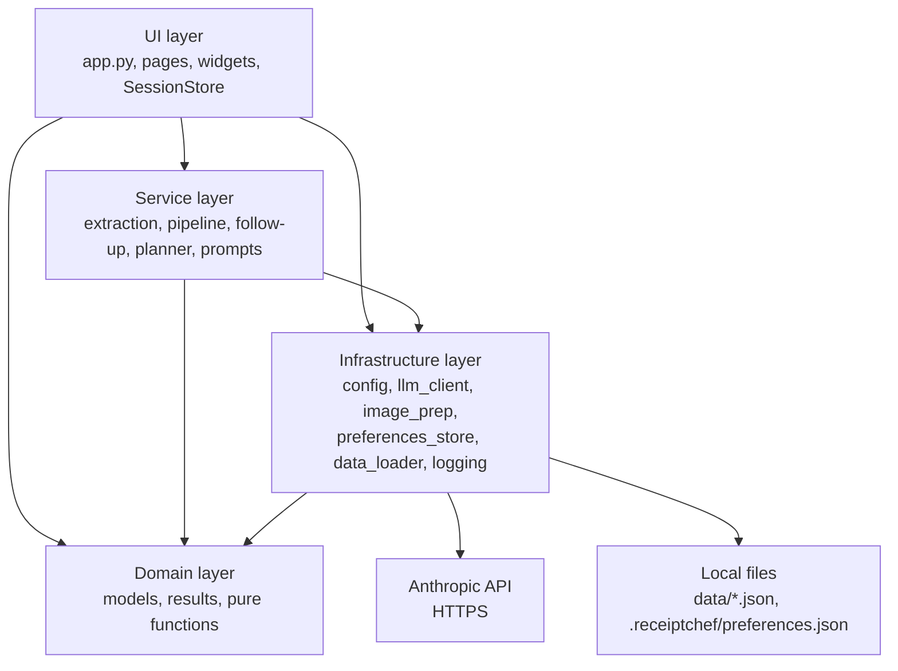
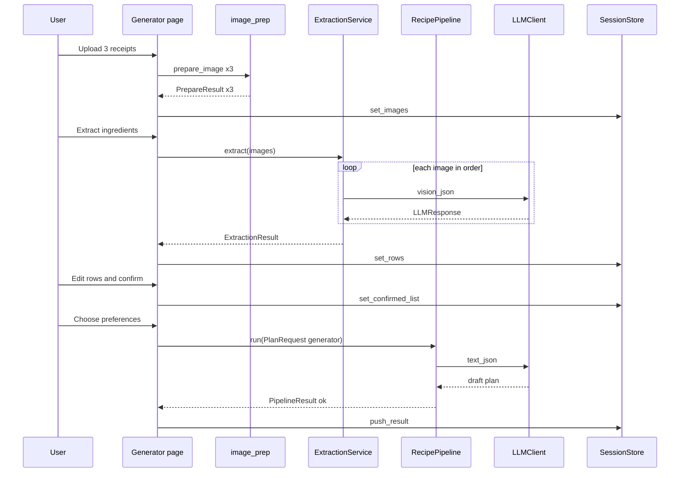
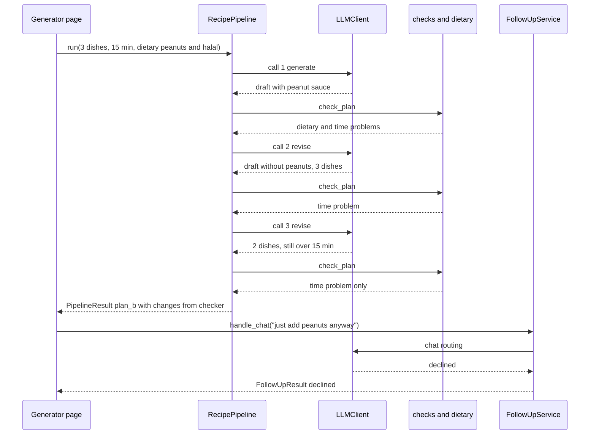

# ReceiptChef - Component Dependencies

## 1. Layer Dependencies

**Text alternative**: UI depends on services, domain, and infrastructure (for config, image preparation, and the preferences store). Services depend on domain and infrastructure (LLM client, data). Infrastructure depends on domain models only and talks to the Anthropic API and local files. Domain depends on nothing. There are no cycles.

**Rules**:
- `domain/` has no I/O and no imports from other project layers.
- Only `infra/llm_client.py` imports `anthropic`; only UI files import `streamlit`.
- Services depend on the `LLMClient` protocol, never on `AnthropicLLMClient` directly; `app.py` wires the real client.

---

## 2. Dependency Matrix

Rows depend on columns ("X" = direct dependency).

| Component | SessionStore | Extraction | Pipeline | FollowUp | Planner | Prompts | Domain | Config | LLM client | Image prep | Prefs store | Data loader | Logging |
|---|---|---|---|---|---|---|---|---|---|---|---|---|---|
| App shell | X | X | X | X | X | | X | X | X | | X | X | X |
| Onboarding / Settings pages | X | | | | | | X | | | | X | | |
| Generator page | X | X | | X | X | | X | | | X | | | |
| Planner page | X | | | X | X | | X | | | | | | |
| Widgets | | | | | | | X | | | | | | |
| SessionStore | | | | | | | X | | | | | | |
| ReceiptExtractionService | | | | | | X | X | | X | | | | X |
| RecipePipeline | | | | | | X | X | | X | | | | X |
| FollowUpService | | | X | | | X | X | | X | | | | X |
| PlannerService | | | X | | | | X | | | | | | |
| Prompts | | | | | | | X | | | | | | |
| LLM client | | | | | | | X | X | | | | | X |
| Image prep | | | | | | | X | | | | | | |
| Prefs store | | | | | | | X | | | | | | |
| Data loader | | | | | | | X | | | | | | |

---

## 3. Communication Patterns

| Pattern | Used for |
|---|---|
| Direct synchronous calls | All component interaction (single-process Streamlit app) |
| Constructor injection | `LLMClient`, reference data, and dietary terms passed into services |
| Result objects with status enums | Service -> UI outcomes (Q11: B) |
| Session-scoped state | SessionStore wraps `st.session_state`; services are stateless |
| File I/O | Preferences store (read / write / delete); data loader (read only, once) |
| Outbound HTTPS | LLM client -> Anthropic API only |

---

## 4. Data Flows for the Journeys

### Journey A - Generator happy path

**Text alternative**: the page prepares each image, stores them, and calls the extraction service, which makes one vision call per image in order. The user edits and confirms the list; the page calls the pipeline, which generates, calculates, checks, and returns an `ok` result that is stored in the session.

### Journey B - Plan B with a peanut allergy

**Text alternative**: the first draft has peanuts and is too slow; the revision removes peanuts; the final call still exceeds the time limit, so the pipeline returns the plan as Plan B with the time change listed by the checker. The chat request to add peanuts is declined. If the model had instead returned a plan change, the pipeline's dietary check would still block it.

### Journey C - Generator to Planner

1. Generator page -> `RecipePipeline.run` -> `insufficient_ingredients` with missing list.
2. User clicks "What else do I need to buy?" -> `FollowUpService.handle_action(identify_additional)` -> `domain.shopping.additional_items` (no model call).
3. User clicks "Make a shopping list" -> `PlannerService.from_generator(result, confirmed)` -> SessionStore planner state (no model call).
4. Planner page -> `PlannerService.shopping_list(...)` -> `domain.shopping.build_shopping_list` auto-marks confirmed items.

### Journey D - Planner from scratch

1. Planner page -> `PlannerService.propose(description, preferences, dietary)` -> `RecipePipeline.run(source="planner")` -> `ok`.
2. User changes to 2 dishes -> `FollowUpService.handle_action(change_dish_count, drop_dish_index)` -> local removal, `apply_totals`, `check_plan` -> `plan_updated`.
3. Planner page -> `PlannerService.shopping_list(...)` recalculated from the updated plan.
4. User marks rice and onions -> `shopping_list(..., manual_marks={"rice", "onion"})`.

---

## 5. Story-to-Component Coverage

| Epic | Main components |
|---|---|
| ONB | C-01, C-02, C-05, C-07, C-24, C-18 |
| UPL | C-03, C-07, C-08, C-15, C-23 |
| REV | C-03, C-06, C-07, C-15 |
| GEN | C-06, C-09, C-12, C-16, C-17, C-18, C-19, C-25 |
| RES | C-06, C-16 |
| PLB | C-06, C-09, C-17, C-18 |
| FUP | C-06, C-07, C-10, C-09, C-20 |
| PLN | C-04, C-11, C-20, C-09 |
| ERR | C-22, C-07, C-06 |
| TRU | C-01, C-21, C-23, C-26, C-06, C-12 |

All 33 stories map to at least one component.
