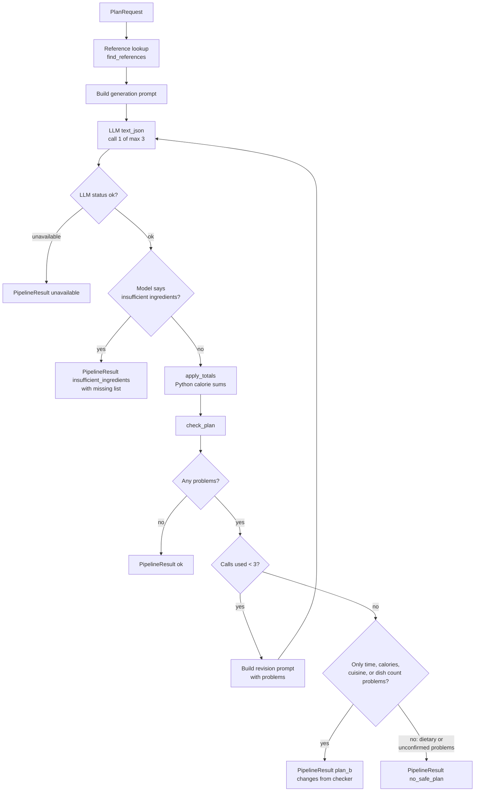

# ReceiptChef - Services and Orchestration

Services live in `src/receiptchef/services/`. They contain no Streamlit code, receive their dependencies through the constructor (Q12: A), and return result objects (Q11: B). The UI decides how to display each result status.

---

## S-1 ReceiptExtractionService

**Responsibility**: Turn 1-3 prepared images into one reviewable ingredient list.

**Orchestration** (Q6: A, sequential):
1. For each image, in order:
   1. Build `extraction_prompt()`.
   2. Call `llm.vision_json(prompt, image, ReceiptExtractionSchema)`.
   3. If `status="invalid_output"`, retry once (FR-2.8). If still invalid, mark that image `invalid_output`.
   4. If `status="unavailable"` (after the client's own retry), mark the image `unavailable` and stop processing remaining images; the UI shows the "Try again" error (US-ERR-01).
   5. If the model reports unreadable or not a receipt, mark that image accordingly with no items.
2. `domain.ingredients.merge_extractions(per_image)` drops non_food items, combines items, and flags duplicates.
3. Return `ExtractionResult` with per-image status and merged rows.

**Re-upload one image** (US-UPL-03): `extract_one(...)` then `merge_into(existing_rows, new)` keeps the user's edits.

**Never**: writes images to disk, logs image content, returns payment or loyalty data (instructed in prompt; also not part of the schema).

---

## S-2 RecipePipeline (shared, Q5: A)

**Responsibility**: The only path that creates or changes a meal plan. Used by Generator, Planner, and plan-changing follow-ups.

**Orchestration**:

**Text alternative**: lookup references -> generate (call 1) -> if the API is unavailable, return `unavailable`; if the model says ingredients are insufficient, return `insufficient_ingredients` with the missing list -> compute calories in Python -> check -> if no problems, return `ok` -> otherwise revise with the problem list (up to 2 revisions, 3 calls total) -> after the last call, if only time / calories / cuisine / dish-count problems remain, return the plan as `plan_b` with the change list computed by the checker; if dietary or unconfirmed-ingredient problems remain, return `no_safe_plan`.

**Key rules** (detailed in Functional Design):
- Plan B never costs an extra call (design decision D-1 in `components.md`).
- Dietary problems are never converted into "changes from your request" (US-PLB-03).
- `invalid_output` from a generation call counts as a used call and is treated like a failed check with a "fix the format" problem.
- The model never supplies totals; `apply_totals` overwrites them.
- `generation_calls` is recorded in the result and logged.

**Request sources**:

| Source | `confirmed` | `description` | `current_plan` / `change` |
|---|---|---|---|
| Generator | Confirmed list | None | None |
| Planner | Generator list if present (for context only) or None | Planner text | None |
| Follow-up | Current list | Planner text if in Planner | Current plan + button action or chat change text |

---

## S-3 FollowUpService (Q7: A)

**Responsibility**: Handle follow-up buttons and chat for both Generator and Planner.

**Button routing (fixed)**:

| Button | Type | Handling |
|---|---|---|
| Replace an ingredient | Plan change | `pipeline.run(change=action)` |
| Suggest a different dish | Plan change | `pipeline.run(change=action)` |
| Change the number of dishes | Plan change | Dropping a dish: local removal then `apply_totals` + `check_plan` (no model call); adding: `pipeline.run` |
| Adjust time or calorie preference | Plan change | `pipeline.run(preferences=new)` |
| Suggest other meals | Plan change | `pipeline.run` with no current plan; UI keeps the previous result (US-FUP-06) |
| Explain a cooking step | Explain only | `llm.text_json(explain_prompt)` -> `FollowUpResult(kind="explanation")` |
| What else do I need to buy? | Explain only | `domain.shopping.additional_items(plan)`; no model call (D-5) |

**Chat routing**:
1. `llm.text_json(chat_prompt(context, text), ChatReplySchema)`; the reply type is `answer`, `plan_change`, or `declined`.
2. `answer` -> show text. `declined` (off topic, attempt to override rules or drop an allergy) -> show the short explanation (US-FUP-08, US-PLB-03).
3. `plan_change` -> `pipeline.run(change=<model's restated change>)`; the result goes through the same checks, so a chat request like "add peanuts anyway" cannot produce a peanut plan even if the model misroutes it.

**Every follow-up** receives the current plan, ingredient list (or Planner "already have" list), recipe preferences, and saved dietary preferences (FR-8.4).

---

## S-4 PlannerService

**Responsibility**: Planner entry, Generator-to-Planner handoff, and shopping list.

| Operation | Orchestration |
|---|---|
| `propose` | Build `PlanRequest(source="planner")` -> `pipeline.run` |
| `from_generator` | Copy current plan, preferences, and confirmed list into `PlannerState`; no model call (US-PLN-04) |
| `shopping_list` | `domain.shopping.build_shopping_list(plan, confirmed, manual_marks, unmarked)`; recalculated every time the plan changes (FR-9.9) |

Store-unit hints come from each `RecipeIngredient.store_unit_hint` produced during generation (Q9: A). When the same ingredient has different hints across dishes, the builder chooses one by a rule set in Functional Design.

---

## S-5 Cross-Cutting Patterns

| Concern | Pattern | Where |
|---|---|---|
| API failure | One automatic retry inside `AnthropicLLMClient`; then `status="unavailable"` result; UI shows "Try again"; SessionStore keeps all data | C-22, C-07, US-ERR-01 |
| Invalid model output | `status="invalid_output"`; extraction retries once; pipeline counts it as a used call | C-08, C-09 |
| Prompt injection | Prompts put receipt text, ingredient names, descriptions, and chat inside delimited data blocks; all outputs validated; all plans checked in Python | C-12, C-17, C-18 |
| Input limits | Pydantic validators on models; UI widgets enforce the same limits | C-13, C-06 |
| Cost limits | Max 3 generation calls per pipeline run; 4,000 output tokens per call | C-09, C-22 |
| Logging | `log_event` with allowed fields only; never prompts, images, keys, or dietary data | C-26 |
| Privacy | EXIF stripped before any call; images held only in SessionStore; only the preferences file is written | C-23, C-07, C-24 |
| Testability | Services receive `LLMClient`; tests inject `FakeLLMClient`; domain functions are pure for PBT | T-01, T-02 |
