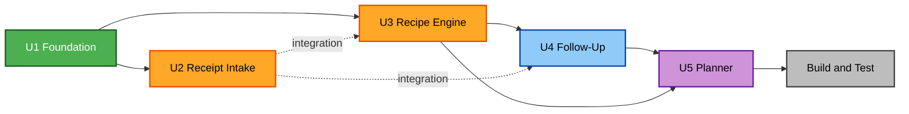

# ReceiptChef - Unit of Work Dependencies

## 1. Dependency Matrix

Rows depend on columns. **Build** = must exist before the row unit's Code Generation. **Integration** = needed only to run the end-to-end journey; the row unit can be built and tested without it (using fakes or samples).

| Unit | U1 Foundation | U2 Receipt Intake | U3 Recipe Engine | U4 Follow-Up | U5 Planner |
|---|---|---|---|---|---|
| **U1 Foundation** | - | | | | |
| **U2 Receipt Intake** | Build | - | | | |
| **U3 Recipe Engine** | Build | Integration (confirmed list; sample list used until ready) | - | | |
| **U4 Follow-Up** | Build | Integration | Build (RecipePipeline, plan view) | - | |
| **U5 Planner** | Build | Integration (Generator handoff) | Build (RecipePipeline, plan view) | Build (follow-up panel, `additional_items`) | - |

No cycles: every dependency points to a unit earlier in the build order.

## 2. Build Sequence (Q2 A)

**Text alternative**: U1 is built first. U2 and U3 are then built in parallel; U3 uses a sample confirmed list until U2 provides the real one (dotted integration link). U4 is built after U3. U5 is built after U3 and U4. Build and Test runs after U5.

## 3. Shared Resources and Interfaces Between Units

| Interface | Provider | Consumers | Type |
|---|---|---|---|
| Domain models and result objects | U1 | All | Python classes (Pydantic) |
| `LLMClient` protocol, `FakeLLMClient` | U1 | U2, U3, U4 | Protocol, test fake |
| SessionStore | U1 | U2, U3, U4, U5 | Class |
| PreferencesStore, `DietaryPreferences` | U1 | U3 (via request), U5 | Class, model |
| `ConfirmedIngredientList` | U2 | U3, U4, U5 | Model in SessionStore |
| `RecipePipeline.run(PlanRequest) -> PipelineResult` | U3 | U4, U5 | Service method |
| `plan_view.render(...)` | U3 | U4, U5 | Widget |
| `followup_panel.render(...)` | U4 | U5 | Widget |
| `domain.shopping.additional_items(plan)` | U4 (created), U5 (owns file) | U4, U5 | Pure function |
| `services/prompts.py` | U3 (owner) | U2, U4 add functions | Module |
| `ui/pages/generator.py` | U2 (owner) | U3, U4 add sections | Page |

All communication is in-process Python calls inside one Streamlit app; there are no network interfaces between units.

## 4. Gates That Affect Ordering

| Gate | Affects | Effect |
|---|---|---|
| Owners agreed at Thursday meeting | All units | Construction does not start until recorded |
| Receipt fixtures collected and blurred | U2 | U2 Construction does not start until ready |
| Team `dietary_terms.json` written and reviewed | U3 | Dietary-check code generation waits; other U3 steps may proceed; no placeholder file |
| Team review of `reference_recipes.json` | U3 | U3 not marked complete until reviewed |

## 5. Parallel Work Guidance

- **U2 and U3 in parallel**: both add to `ui/pages/generator.py` and `services/prompts.py`. U2 owns the page; U3 owns prompts. Each adds new sections or functions only (shared-file rule in `unit-of-work.md` Section 3).
- **U3 before U2 is ready**: U3 tests and the Generator results section use a sample `ConfirmedIngredientList` fixture in `tests/u3_recipe_engine/`.
- **Model changes**: any change to an existing field in `models.py` or `results.py` during parallel work needs a note in the changing unit's Functional Design and agreement from the other unit's owners (Q4 A).
