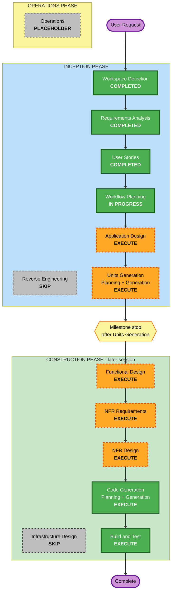

# ReceiptChef - Execution Plan

**Stage**: INCEPTION - Workflow Planning
**Date**: 2026-11-24
**Inputs**: `requirements.md` (approved), `stories.md` and `personas.md` (approved), `aidlc-state.md`

---

## Detailed Analysis Summary

### Transformation Scope
Not applicable (greenfield project; no existing code).

### Change Impact Assessment
- **User-facing changes**: Yes. The whole product is new: onboarding, Generator (upload, review, preferences, results, Plan B), follow-up buttons and chat, Planner with shopping list (33 stories).
- **Structural changes**: Yes. New application with several components: Streamlit UI, a single LLM client, receipt extraction, the app-coordinated recipe pipeline (reference lookup, generate, calculate, check, revise), Plan B logic, follow-up handling, shopping-list logic, and a preferences store.
- **Data model changes**: Yes. New Pydantic models (for example `ReceiptItem`, `ConfirmedIngredient`, `DietaryPreferences`, `RecipePreferences`, `Recipe`, `MealPlan`, `ShoppingListItem`, `FollowUpRequest`), a local preferences JSON file, and the bundled `data/reference_recipes.json`.
- **API changes**: No public API. Internal interfaces only, plus the outbound Anthropic API (vision and structured JSON output).
- **NFR impact**: Yes. Privacy (EXIF stripping, no disk writes, redacted logging), prompt-injection limits, cost limits (3 generation calls, 4,000 output tokens, one retry), testability (fake LLM client, 80% coverage), and property-based testing (Partial; Hypothesis).

### Risk Assessment
- **Risk Level**: Medium. Greenfield and local only, but relies on non-deterministic model output and dietary safety rules, with a fixed December 16 deadline and five people working in parallel.
- **Rollback Complexity**: Easy (local app, Git history, no deployed infrastructure).
- **Testing Complexity**: Moderate. Pure functions are easy to test; model-dependent behavior needs recorded responses, fixture receipts, and the manual quality checklist (QC-1 to QC-13).

---

## Workflow Visualization

**Text alternative**: Workspace Detection (completed) -> Reverse Engineering (skipped, greenfield) -> Requirements Analysis (completed) -> User Stories (completed) -> Workflow Planning (in progress) -> Application Design (execute) -> Units Generation (execute) -> **milestone stop** -> in a later session: Functional Design, NFR Requirements, NFR Design (execute per unit), Infrastructure Design (skip), Code Generation and Build and Test (always) -> Operations (placeholder).

---

## Phases to Execute

### 🔵 INCEPTION PHASE
- [x] Workspace Detection (COMPLETED)
- [x] Reverse Engineering (SKIPPED - greenfield, no existing code)
- [x] Requirements Analysis (COMPLETED)
- [x] User Stories (COMPLETED - 3 personas, 33 stories)
- [x] Workflow Planning (IN PROGRESS)
- [ ] Application Design - **EXECUTE**
  - **Rationale**: Several new components need defined responsibilities, methods, and dependencies: UI pages, `llm_client`, receipt extraction, image preparation, the recipe pipeline (reference lookup, calculate, check, revise), Plan B, follow-up handling, shopping-list builder, and preferences store. Clear boundaries let five people work in parallel and keep the single-client rule (NFR-1.4).
- [ ] Units Generation - **EXECUTE**
  - **Rationale**: The system needs to be split into units the team can build in order (Generator phase before Planner phase, per the story labels) and divide between members. README and Q22 require the units of work to be approved at the end of this milestone.

**Milestone stop (Q22)**: this workflow stops after Units Generation is approved. Construction begins in a later session.

### 🟢 CONSTRUCTION PHASE (later session, per unit)
- [ ] Functional Design - **EXECUTE**
  - **Rationale**: New data models and detailed business rules: whole-set time limit, per-dish calorie ranges, dietary check including hidden allergen sources (US-PLB-03), Plan B labeling, duplicate handling, shopping-list combination and "already have" marking. Also where testable properties are identified (PBT-01, advisory under Partial mode) to support the blocking PBT-02 / PBT-03 rules.
- [ ] NFR Requirements - **EXECUTE** (minimal depth)
  - **Rationale**: Records tech-stack decisions including the PBT framework (**PBT-09 is blocking**: Hypothesis must be documented here), plus privacy, prompt-injection, cost, logging, and coverage requirements per unit. Most of the stack is already fixed, so depth stays minimal.
- [ ] NFR Design - **EXECUTE** (minimal depth)
  - **Rationale**: Turns the NFRs into concrete patterns: one-retry wrapper in `llm_client`, revision-loop cap, input-length validation, data-not-instructions prompt structure, log redaction, EXIF stripping, and the fake LLM client for tests.
- [ ] Infrastructure Design - **SKIP**
  - **Rationale**: The app runs locally only (NFR-7). No cloud resources, containers, or deployment architecture. The only external service is the Anthropic API.
- [ ] Code Generation - **EXECUTE** (ALWAYS)
  - **Rationale**: Implementation planning and code generation, including example-based and property-based tests (PBT-02, PBT-03, PBT-07, PBT-08 blocking).
- [ ] Build and Test - **EXECUTE** (ALWAYS)
  - **Rationale**: Build, test, coverage, live receipt test, and calorie spot-check instructions; PBT seed logging (PBT-08).

### 🟡 OPERATIONS PHASE
- [ ] Operations - **PLACEHOLDER**
  - **Rationale**: Future deployment and monitoring workflows; not needed for a local MVP.

---

## Estimated Timeline

- **Total stages**: 14 (11 completed or to execute; 2 skipped: Reverse Engineering, Infrastructure Design; 1 placeholder: Operations)
- **Remaining stages this milestone**: Application Design, Units Generation (target: complete by 2026-11-26, before the next team meeting)
- **Construction (later session)**: about 2026-11-27 to 2026-12-12, Generator-phase units first, then Planner-phase units
- **Build and Test**: about 2026-12-12 to 2026-12-15
- **Final deadline**: 2026-12-16

These dates are estimates based on the December 16 deadline and the team's Tuesday / Thursday meetings.

---

## Success Criteria

- **Primary goal**: A local Streamlit app where international students turn receipts into checked recipe plans (Generator) and meal ideas into combined shopping lists (Planner), with dietary preferences never relaxed.
- **Key deliverables**:
  - This milestone: approved requirements, user stories, execution plan, application design, and units of work
  - Final: working app in `src/receiptchef/`, tests in `tests/`, `data/reference_recipes.json`, build and test instructions
- **Quality gates**:
  - All 33 stories' acceptance criteria pass (automated where possible; manual for UI flows)
  - Journeys A-D run end to end as demo scripts
  - At least 80% line coverage (excluding UI), ruff and mypy clean
  - PBT for round-trips and invariants with Hypothesis, seeds logged
  - Manual quality checklist (QC-1 to QC-13) recorded for the fixture receipts
  - No real API calls in unit tests

---

## Extension Compliance (Workflow Planning)

| Extension | Status | Notes |
|---|---|---|
| Security Baseline | Disabled | Skipped (Q23) |
| Resiliency Baseline | Disabled | Skipped (Q24) |
| Property-Based Testing (Partial) | No rules apply at this stage (N/A) | Plan schedules PBT-09 in NFR Requirements, PBT-02 / 03 / 07 / 08 in Code Generation, and PBT-08 in Build and Test |
